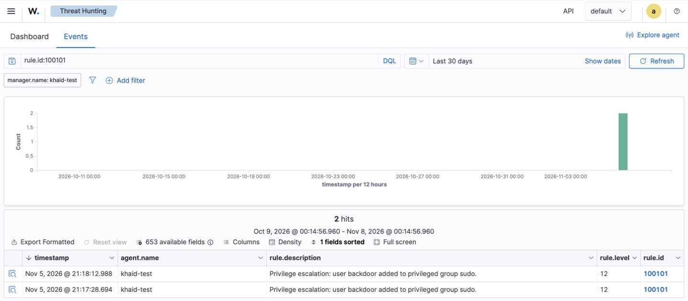
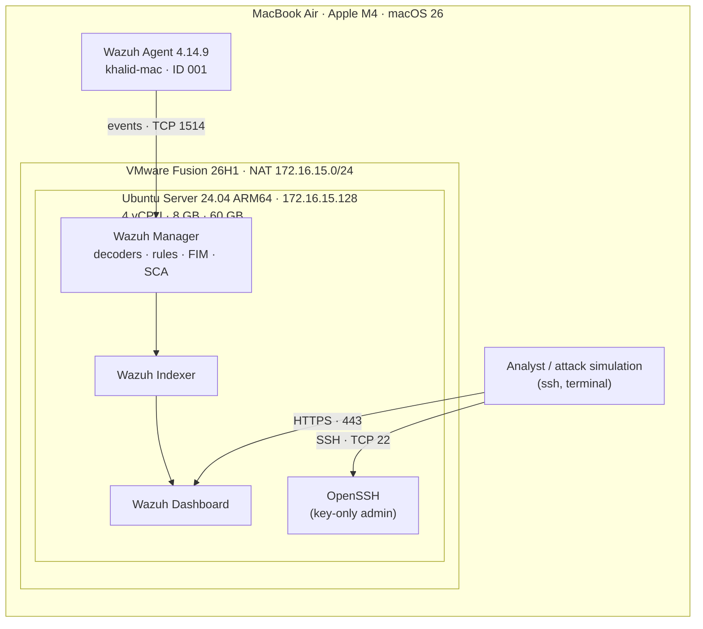
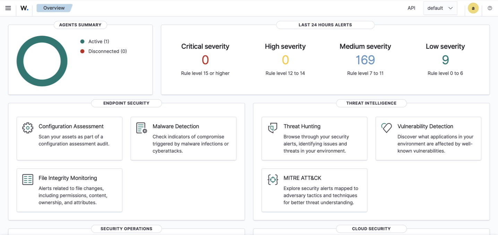
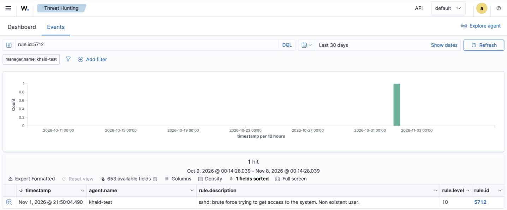
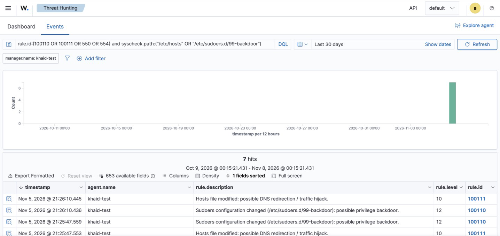

# SOC Home Lab — Detection Engineering & Incident Response with Wazuh


A hands-on Security Operations lab built on a MacBook Air (Apple M4) to put **CompTIA Security+ (SY0-701)**
into practice: SIEM deployment, endpoint onboarding, adversary simulation, detection engineering,
incident investigation and hardening.

## Key Results
- Simulated **3 attack scenarios** mapped to MITRE ATT&CK and wrote a full incident report for each.
- Found **2 real detection gaps** in a default Wazuh 4.14 deployment and closed them with
  **a custom decoder, 4 custom rules and a real-time FIM policy** — each validated with positive *and* negative tests.
- Cut time-to-detect for critical file tampering from **up to 12 hours to under 1 second**.


<sub>Custom rule 100101 (level 12) catching a backdoor account being added to `sudo` — an event the default ruleset missed.</sub>

## Architecture



| Component | Version / Detail |
|---|---|
| Hypervisor | VMware Fusion 26H1u1 (Universal) |
| SIEM server | Ubuntu Server 24.04.5 LTS ARM64 |
| SIEM / XDR | Wazuh 4.14.9 all-in-one (manager, indexer, dashboard) |
| Endpoints | Wazuh server itself (agent 000) · macOS 26 laptop (agent 001, Apple-notarized arm64 package) |

## Detection Scenarios

| # | Scenario | MITRE | Default Wazuh | After my work | Report |
|---|---|---|---|---|---|
| 1 | SSH brute force (non-existent user) | T1110 | ✅ Detected & correlated (5710 → **5712**, lvl 10) | Hardening recommendations | [IR-2026-001](reports/01-ssh-brute-force.md) |
| 2 | Backdoor admin account (`useradd` + `usermod -aG sudo`) | T1136.001 · T1098 · T1078.003 | ⚠️ Account creation seen, **sudo grant missed** | Custom decoder + rules → **100101, lvl 12** | [IR-2026-002](reports/02-privilege-escalation.md) |
| 3 | Hosts-file poisoning & sudoers drop-in | T1565.001 · T1548.003 | ❌ **Not detected for up to 12 h** | Real-time FIM + rules → **100110 (lvl 12)**, **100111 (lvl 10)** | [IR-2026-003](reports/03-file-integrity-monitoring.md) |

## Custom Detections
All in [`detections/`](detections/), ready to drop into `/var/ossec/etc/`:

| ID | Level | Detects | Why it was needed |
|---|---|---|---|
| decoder `usermod-group-add` | — | Parses `usermod: add 'USER' to group 'GROUP'` | Stock rule 2961 only parses `gpasswd`; `usermod -aG` was invisible |
| 100100 | 8 | Any user added to a group | Base event for the chain |
| **100101** | **12** | User added to `sudo` / `admin` / `wheel` | Privilege escalation was undetected |
| **100110** | **12** | Any change under `/etc/sudoers*` | Root backdoor surfaced only as generic level-5 "file added" |
| **100111** | **10** | `/etc/hosts` modified | DNS-hijack had no specific priority |
| FIM policy | — | Real-time + diff on `/etc/hosts`, `passwd`, `group`, `sudoers*`, `sshd_config`, cron | Default scan interval was 12 h |

Engineering process for every detection: reproduce the attack → confirm the gap with `wazuh-logtest` →
write decoder/rule → **positive test** (fires on the attack) → **negative test** (silent on near-identical
benign lines) → live re-test → document.

## Screenshots

> Timestamps in the dashboard screenshots are shown in the browser's display time zone (UTC+8); all times in the incident reports and evidence files are UTC.

| | |
|---|---|
|  **Overview** — agents and alert severity |  **Scenario 1** — SSH brute force correlated into rule 5712 |
|  **Scenario 2** — custom rule 100101 with decoded fields |  **Scenario 3** — real-time FIM with custom rules 100110 / 100111 |

## Baseline Findings
On first connection, Wazuh's **Security Configuration Assessment** ran CIS Benchmarks against both hosts
(CIS Ubuntu 24.04 v1.0.0, CIS macOS 26 Tahoe v1.0.0) and flagged misconfigurations such as missing login
banners, no separate `/tmp`/`/var` partitions and weak password-policy settings.

## Repository Layout

```
reports/      Incident reports, one per scenario
detections/   Custom decoder, rules and FIM configuration
evidence/     Raw logs and Wazuh alert JSON backing each report
screenshots/  Wazuh dashboard captures
docs/         Lab build guide
```

Want to rebuild the lab? See [docs/SETUP.md](docs/SETUP.md).

## Skills Demonstrated
- Deploying and operating a SIEM (Wazuh) on ARM64 virtual infrastructure; agent enrollment
- **Detection engineering:** custom decoders (PCRE2), rule chaining, severity tuning, false-positive removal
- File Integrity Monitoring design (real-time scope vs. cost)
- Log analysis and incident investigation mapped to MITRE ATT&CK
- Incident reporting: timeline, evidence, root cause, remediation, lessons learned

## Security+ SY0-701 Domains Covered
- **Domain 2** — Threats, Vulnerabilities & Mitigations (indicators of malicious activity)
- **Domain 4** — Security Operations (alerting & monitoring, IAM, enhancing capabilities, incident response, investigation)

> All activity was performed in an isolated lab on equipment I own. No production or employer data is included.
