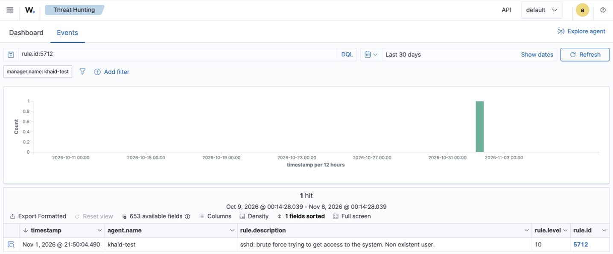

# Incident Report 01 — SSH Brute-Force Against Lab Server

| Field | Value |
|---|---|
| Report ID | IR-2026-001 |
| Date (UTC) | 2026-11-01, 13:50:03 – 13:50:04 |
| Analyst | Khalid Alogran |
| Severity | **High** (Wazuh rule level 10) |
| Status | Closed — simulated test, remediation recommended |
| Affected asset | `khaid-test` (Ubuntu 24.04 ARM64, Wazuh manager, 172.16.15.128) |
| Source | `172.16.15.1` (lab MacBook, host-only NAT gateway) |
| MITRE ATT&CK | T1110 Brute Force · T1110.001 Password Guessing · T1021.004 Remote Services: SSH |

## 1. Summary
Ten SSH login attempts were made within ~1 second against the lab server using a
non-existent account (`attacker`). Wazuh raised a **level-5 alert per attempt** (rule 5710)
and correlated them into a **level-10 brute-force alert** (rule 5712) after the 8th attempt.
This was a controlled simulation to validate detection of credential-access attacks.

## 2. Detection

| Rule | Level | Description | Count |
|---|---|---|---|
| 5710 | 5 | sshd: Attempt to login using a non-existent user | 9 |
| **5712** | **10** | **sshd: brute force trying to get access to the system. Non existent user.** | **1** |



Rule 5712 is a **frequency rule**: it fires when rule 5710 matches **8 times** from the same
source within the rule's timeframe. That correlation is what turns noisy single failures into one
actionable alert.

Compliance mappings attached by Wazuh to rule 5712: PCI DSS 10.2.4 / 10.2.5 / 11.4,
NIST 800-53 SI.4 / AU.14 / AC.7, HIPAA 164.312.b.

## 3. Evidence
Raw `sshd` log (`/var/log/auth.log`) — full file: [`evidence/01-ssh-brute-force/auth.log`](../evidence/01-ssh-brute-force/auth.log)

```
2026-11-01T13:50:03.653352+00:00 khaid-test sshd[7590]: Invalid user attacker from 172.16.15.1 port 49475
2026-11-01T13:50:03.656689+00:00 khaid-test sshd[7590]: Connection closed by invalid user attacker 172.16.15.1 port 49475 [preauth]
2026-11-01T13:50:03.722457+00:00 khaid-test sshd[7592]: Invalid user attacker from 172.16.15.1 port 49476
```

Wazuh alert (trimmed) — full alerts: [`evidence/01-ssh-brute-force/alerts.json`](../evidence/01-ssh-brute-force/alerts.json)

```json
{
  "timestamp": "2026-11-01T13:50:04.490+0000",
  "rule": { "id": "5712", "level": 10, "frequency": 8,
            "description": "sshd: brute force trying to get access to the system. Non existent user.",
            "mitre": { "id": ["T1110"], "tactic": ["Credential Access"] } },
  "agent": { "id": "000", "name": "khaid-test" },
  "data": { "srcip": "172.16.15.1", "srcuser": "attacker" }
}
```

Dashboard query used: **Threat Hunting →** `rule.id:5712` (and `rule.id:5710` for the individual attempts).

## 4. Analysis
- **Who:** single source IP `172.16.15.1`; account `attacker` does not exist on the host.
- **What:** 10 authentication attempts, all rejected at `[preauth]` — no session was established.
- **Pattern:** sequential source ports (49475 → 49484) and ~10 attempts/second indicate an
  automated tool, not a human typing.
- **Impact:** none — the account does not exist and no successful login (rule 5715) followed.
  Verified: no `rule.id:5715` alerts for `srcuser:attacker`, and no sshd `Accepted` entries for
  that user in `auth.log`.

## 5. Findings (configuration at time of test)

| Setting | Value | Risk |
|---|---|---|
| `PasswordAuthentication` | `yes` | Password guessing is possible against real accounts |
| `MaxAuthTries` | `6` | Allows several guesses per connection |
| `PermitRootLogin` | `without-password` | Root via key only — acceptable |

## 6. Response & Remediation
Because this was a simulation, no containment was required. Recommended hardening:

1. **Disable password authentication** — key-based SSH only (`PasswordAuthentication no`).
   Key-based access for the analyst is already configured.
2. **Lower `MaxAuthTries` to 3.**
3. **Enable Wazuh Active Response** (`firewall-drop`) on rule 5712 to automatically block the
   source IP for a set period.
4. Keep SSH reachable only from the lab network (it is not exposed to the internet).

## 7. Verification (to do after remediation)
Re-run the same simulation and confirm:
- the connection is refused for password auth, and/or
- Active Response logs a `firewall-drop` for `172.16.15.1` and subsequent attempts time out.

## 8. Reproduction
From the analyst Mac (lab only):

```bash
for i in $(seq 1 10); do
  ssh -o BatchMode=yes -o PreferredAuthentications=password,keyboard-interactive \
      -o ConnectTimeout=3 attacker@172.16.15.128 true
done
```

## 9. Security+ (SY0-701) mapping
- **2.4** Analyze indicators of malicious activity — password/brute-force attacks
- **4.4** Security alerting and monitoring — SIEM, log aggregation, alert tuning
- **4.8** Incident response process — detection, analysis, lessons learned
- **4.9** Use data sources to support an investigation — log data, SIEM dashboards
