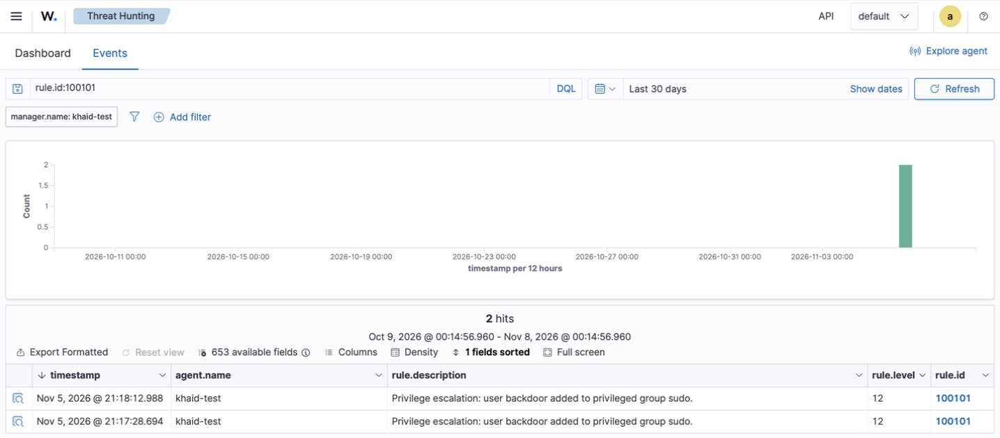

# Incident Report 02 — Privilege Escalation via Backdoor Admin Account (Detection Gap Fixed)

| Field | Value |
|---|---|
| Report ID | IR-2026-002 |
| Date (UTC) | 2026-11-01 17:30:48 (initial test) · 2026-11-05 13:17–13:18 (re-test after fix) |
| Analyst | Khalid Alogran |
| Severity | **Critical** (custom rule level 12) |
| Status | Closed — simulated test; **detection gap identified and remediated** |
| Affected asset | `khaid-test` (Ubuntu 24.04 ARM64, 172.16.15.128) |
| Actor | Interactive session of user `khalid` via SSH (`/dev/pts/1`) |
| MITRE ATT&CK | T1136.001 Create Account: Local · T1098 Account Manipulation · T1078.003 Valid Accounts: Local |

## 1. Summary
An attacker with a foothold commonly creates a local account and adds it to an administrative group
to keep privileged access (**persistence**). This was simulated on the lab server.
Wazuh detected the account creation, **but the most critical step — adding the account to the `sudo`
group — produced no alert**. Root cause was traced to a missing decoder for Ubuntu 24.04's log format.
A custom decoder and two rules were written, tested, tuned and validated; the escalation now raises a
**level-12** alert.

## 2. Simulation

```bash
sudo useradd -m backdoor          # T1136.001 — create local account
sudo usermod -aG sudo backdoor    # T1098 — grant admin rights
groups backdoor                   # → backdoor : backdoor sudo
```

## 3. Initial Detection (built-in ruleset)

| Time (UTC) | Rule | Level | Description | Detected? |
|---|---|---|---|---|
| 17:30:48 | 5901 | 8 | New group added to the system | ✅ |
| 17:30:48 | 5902 | 8 | New user added to the system (T1136) | ✅ |
| 17:31:00 | 2961 | 5 | User added to group sudo | ❌ **No alert** |

The privilege grant — the step that turns a plain account into a backdoor admin — was invisible to the SIEM.

## 4. Root-Cause Analysis
The event *was* logged by the OS (`/var/log/auth.log`):

```
2026-11-01T17:31:00.660145+00:00 khaid-test usermod[9411]: add 'backdoor' to group 'sudo'
2026-11-01T17:31:00.688809+00:00 khaid-test usermod[9411]: add 'backdoor' to shadow group 'sudo'
```

Replaying it through `wazuh-logtest`:

```
**Phase 1: Completed pre-decoding.
        program_name: 'usermod'
**Phase 2: Completed decoding.
        No decoder matched.
```

Built-in rule 2961 is a child of rule 2960, which is defined as `<decoded_as>gpasswd</decoded_as>` +
`<match>added by</match>` — it only covers the message written by **`gpasswd -a`**
(`user X added by Y to group Z`). The equally common **`usermod -aG`** writes
`add 'USER' to group 'GROUP'`, which no stock decoder parses, so the rule chain never starts.
**Conclusion: log source present, parsing missing → detection gap for one of two common admin-grant commands.**

## 5. Detection Engineering — Fix
Files: [`detections/local_decoder.xml`](../detections/local_decoder.xml) ·
[`detections/local_rules.xml`](../detections/local_rules.xml)

**Decoder** — matches only the real group-add line and extracts `dstuser` and `group`:

```xml
<decoder name="usermod-group-add">
  <program_name>^usermod$</program_name>
  <prematch type="pcre2">^add \x27[^\x27]+\x27 to group </prematch>
  <regex type="pcre2">^add \x27([^\x27]+)\x27 to group \x27([^\x27]+)\x27$</regex>
  <order>dstuser, group</order>
</decoder>
```

**Rules**

| Rule | Level | Logic | MITRE |
|---|---|---|---|
| 100100 | 8 | Any user added to any group | T1098 |
| **100101** | **12** | Child of 100100 where `group` is `sudo`, `admin` or `wheel` | T1098, T1078.003 |

### Engineering notes
- **Regex engine:** the first version used OS_Regex and decoded nothing; the single quotes in the log
  also broke when written as XML entities. Switching to `type="pcre2"` with `\x27` for `'` fixed field extraction.
- **Tuning (false positive removed):** `usermod` logs a second line, `... to shadow group 'sudo'`. The first
  version matched it too and produced an extra level-8 alert with empty fields. Adding a strict `prematch`
  excludes it. Validated with `wazuh-logtest`:

| Input line | Before tuning | After tuning |
|---|---|---|
| `add 'backdoor' to group 'sudo'` | 100101 (lvl 12) ✅ | 100101 (lvl 12) ✅ |
| `add 'backdoor' to shadow group 'sudo'` | 100100 (lvl 8, empty fields) ❌ | no match ✅ |

## 6. Validation (live re-test, 2026-11-05)

```bash
sudo gpasswd -d backdoor sudo
sudo usermod -aG sudo backdoor
```

| Time (UTC) | Rule | Level | Description |
|---|---|---|---|
| 13:17:28 | **100101** | **12** | Privilege escalation: user backdoor added to privileged group sudo. (first live run after deployment) |
| 13:18:12 | **100101** | **12** | Privilege escalation: user backdoor added to privileged group sudo. (re-test: removed, then re-added) |



Decoded fields: `data.dstuser: backdoor`, `data.group: sudo`. Full alerts:
[`evidence/02-privilege-escalation/alerts.json`](../evidence/02-privilege-escalation/alerts.json)

Dashboard query: **Threat Hunting →** `rule.id:100101` or `rule.mitre.tactic:"Privilege Escalation"`

## 7. Analysis of the Original Event
From alert 5902 (`full_log`):
`new user: name=backdoor, UID=1001, GID=1001, home=/home/backdoor, shell=/bin/sh, from=/dev/pts/1`

- **UID 1001** — first new human account after the admin (1000): unexpected.
- **Login shell + home directory** — built to be used interactively, unlike service accounts (`nologin`).
- **`from=/dev/pts/1`** — created from an interactive SSH terminal, i.e. hands-on-keyboard activity.
- **Sequence** — account creation followed 12 s later by `sudo` membership is a classic persistence pattern.

## 8. Response & Remediation
- **Containment (lab):** account removed — `sudo userdel -r backdoor`; verified with `id backdoor` → *no such user*.
- **Detection:** custom decoder + rules deployed (this report).
- **Recommended hardening:**
  - Alert on any change to `/etc/sudoers` and `/etc/sudoers.d/` via FIM (see scenario 3).
  - Periodically review membership of `sudo`/`admin` groups against an approved list.
  - Raise the risk of 5902 (new user) when followed by 100101 within a short window (correlation rule).

## 9. Lessons Learned
- **A SIEM is only as good as its parsers.** Default rules can silently miss an attack just because it was
  done with a different command (`usermod` vs `gpasswd`) — detections must be validated, not assumed.
- `wazuh-logtest` is the fastest way to prove whether a gap is in collection, decoding or rule logic.
- Every new detection needs a **positive test** (fires on the attack) and a **negative test** (stays quiet on
  near-identical benign lines).

## 10. Security+ (SY0-701) mapping
- **2.4** Indicators of malicious activity — account creation, privilege escalation
- **4.4** Security alerting and monitoring — SIEM, alert tuning, false positives
- **4.6** Identity and access management — privileged access, least privilege
- **4.8 / 4.9** Incident response and investigation data sources
