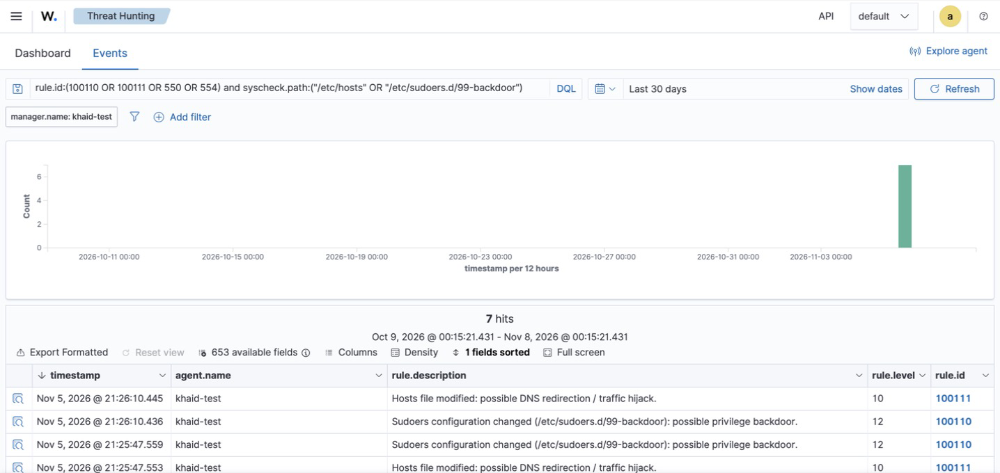

# Incident Report 03 — Tampering With Critical Files (FIM Gap Closed)

| Field | Value |
|---|---|
| Report ID | IR-2026-003 |
| Date (UTC) | 2026-11-05, 13:19 – 13:26 |
| Analyst | Khalid Alogran |
| Severity | **Critical** (custom rule level 12) |
| Status | Closed — simulated test; **monitoring gap identified and remediated** |
| Affected asset | `khaid-test` (Ubuntu 24.04 ARM64, 172.16.15.128) |
| MITRE ATT&CK | T1565.001 Stored Data Manipulation · T1548.003 Sudo and Sudo Caching |

## 1. Summary
Two post-compromise techniques were simulated against critical system files:

1. **Hosts-file poisoning** — redirect `login.microsoftonline.com` to an attacker IP (credential phishing / traffic hijack).
2. **Sudoers drop-in backdoor** — add `/etc/sudoers.d/99-backdoor` granting password-less root.

With the default configuration, **neither change raised an alert** because File Integrity Monitoring (FIM)
only scans `/etc` every **12 hours**. After enabling real-time FIM on high-value files and adding two
severity rules, both techniques were detected **within the same second**, including the exact line changed.

## 2. Baseline Test (default configuration)

Default FIM (`ossec.conf`):

```xml
<frequency>43200</frequency>                       <!-- full scan every 12 h -->
<directories>/etc,/usr/bin,/usr/sbin</directories> <!-- no realtime, no diff -->
```

| Time (UTC) | Action | Alert within 45 s? |
|---|---|---|
| 13:19:41 | Appended `6.6.6.6 login.microsoftonline.com` to `/etc/hosts` | ❌ **None** |

**Gap:** an attacker could poison DNS resolution and keep it in place for up to 12 hours before the next scan
— and could revert it before the scan ever ran.

## 3. Remediation — Configuration & Detection Engineering
Files: [`detections/ossec-syscheck-snippet.xml`](../detections/ossec-syscheck-snippet.xml) ·
[`detections/local_rules.xml`](../detections/local_rules.xml)

**Real-time FIM with content diffs** on the files attackers most often touch for persistence and privilege:

```xml
<directories realtime="yes" report_changes="yes" check_all="yes">
  /etc/hosts,/etc/passwd,/etc/group,/etc/sudoers,/etc/sudoers.d,
  /etc/ssh/sshd_config,/etc/crontab,/etc/cron.d
</directories>
```

**Severity rules.** Stock FIM alerts are generic ("File added", level 5) and the sudoers drop-in carried no
MITRE mapping — a root backdoor would sit among routine noise. Two child rules raise priority by path:

| Rule | Level | Parent | Condition | MITRE |
|---|---|---|---|---|
| **100110** | **12** | 550 / 553 / 554 | path starts with `/etc/sudoers` | T1548.003 |
| **100111** | **10** | 550 | path is `/etc/hosts` | T1565.001 |

## 4. Validation (after remediation)

```bash
echo "6.6.6.6 login.microsoftonline.com  # SOC-LAB TEST" | sudo tee -a /etc/hosts
echo "backdoor ALL=(ALL) NOPASSWD:ALL"   | sudo tee /etc/sudoers.d/99-backdoor
```

| Time (UTC) | Rule | Level | Description | File | Mode |
|---|---|---|---|---|---|
| 13:24:37 | 550 | 7 | Integrity checksum changed (before custom rules) | `/etc/hosts` | realtime |
| 13:24:37 | 554 | 5 | File added to the system (before custom rules) | `/etc/sudoers.d/99-backdoor` | realtime |
| 13:25:47 | **100111** | **10** | Hosts file modified: possible DNS redirection / traffic hijack | `/etc/hosts` | realtime |
| 13:25:47 | **100110** | **12** | Sudoers configuration changed: possible privilege backdoor | `/etc/sudoers.d/99-backdoor` | realtime |



**Content diff captured by FIM** (`syscheck.diff`) — shows exactly what the attacker added:

```
9a10
> 6.6.6.6 login.microsoftonline.com  # SOC-LAB TEST
```

Full alerts: [`evidence/03-file-integrity/alerts.json`](../evidence/03-file-integrity/alerts.json)
Dashboard: **File Integrity Monitoring** module, or **Threat Hunting →** `rule.id:(100110 OR 100111)`

## 5. Analysis
- **Time to detect:** from up to 12 h (scheduled scan) to **< 1 s** (real-time, inotify).
- **Evidence quality:** `report_changes` stores the diff, so the analyst sees *what* changed, not only *that*
  a hash changed — enough to scope impact (which domain was hijacked, which account got root) without
  logging into the host.
- **Prioritisation:** the sudoers backdoor moved from level 5 (easily missed) to level 12, above the
  level-10 hosts tamper — it grants full root and is the more severe of the two.
- **Note:** `/etc/shadow` and `/etc/gshadow` stay under `nodiff` by default so password hashes are never
  copied into the SIEM — preserved intentionally.

## 6. Response
- `/etc/hosts` restored from a known-good copy; `grep -c SOC-LAB /etc/hosts` → `0`.
- `/etc/sudoers.d/99-backdoor` removed.
- The cleanup itself was detected in real time (13:26:10 UTC): rule **100110** fired again for the sudoers
  file deletion and **100111** for the hosts-file restore — any later change to these files, including an
  attacker covering their tracks, is visible.

## 7. Lessons Learned
- **Collection ≠ coverage.** FIM was "enabled", but a 12-hour interval makes it useless for files whose
  tampering matters in minutes. Coverage must be measured against attacker timelines.
- Stock rule levels reflect *generic* risk; the defender must raise severity for **context** (which file).
- Real-time monitoring has a cost — scope it to high-value paths instead of entire trees.

## 8. Security+ (SY0-701) mapping
- **2.4** Indicators of malicious activity — file integrity changes, privilege escalation
- **4.4** Security alerting and monitoring — FIM, alert tuning
- **4.5** Modify enterprise capabilities to enhance security — file integrity monitoring
- **4.8 / 4.9** Incident response and investigation data sources
